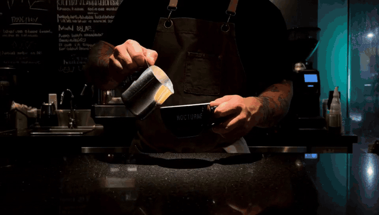

# ComfyUI SPEED Sampler

> [!WARNING]
> **Noncommercial** — [LICENSE.md](LICENSE.md) (PolyForm Noncommercial 1.0.0).
> I don't expect this to be used commercially. If it genuinely will be, message me.

> *"Why make big noise when little noise do trick?"*

Make video and image generation faster without retraining.

- SPEED starts denoising on a cheaper low-resolution grid, then increases the resolution as finer detail becomes useful.
- This avoids paying for full-resolution compute during the noisiest early steps.
- **Runs on:** MiniMax-H3 video and flow image models (MOSS Image, Krea 2).
- H3 audio always stays at full resolution.


## Installation

```bash
cd ComfyUI/custom_nodes/
git clone https://github.com/StanLukuvka/ComfyUI-SPEED.git
# restart ComfyUI
```

## Quick start

1. **Swap in the SPEED node.**
   - **Image models** (MOSS Image, Krea 2): swap your **KSampler** for **SPEED — KSampler**, using the same wiring as KSampler. Example: [image_moss_SPEED](workflows/image_moss_SPEED.json).
   - **H3**: replace **SamplerCustomAdvanced** with **SPEED — Sampler Advanced**, using the same wiring. Example: [video_h3_SPEED](workflows/video_h3_SPEED.json).
2. **Fill in `noise_amplitude` and `noise_decay_exponent`.** They describe how your model, sampler and schedule behave; left at 0, the node stops with an error.
   - Run a **Sigma Harvest** node once with the same sampler, schedule and size, and copy its numbers (see [Sigma Harvest](#sigma-harvest)).
3. **Set `stages` and `Tolerance (Delta)`** (Δ below), then queue: Δ 0.005 for video, 0.05 for images.

> [!TIP]
> For base H3 with `euler`, the reference values `noise_amplitude = 35.4213`, `noise_decay_exponent = 1.0126` (r² 0.83) work as a start; Harvest gives values for your own workflow.

## Evidence

Same seed and prompt for every run, so native and SPEED can be compared directly. All results use Euler.

### MiniMax-H3 video

| Native | SPEED, 4 stages, Δ 0.05 (1.58×) |
|---|---|
|  |  |

- **Clip:** a 5 s 0.5 MP latte-art pour in a dark café, Modal L40S.
- **Calibration:** one Harvest run (`noise_amplitude` A 35.4213, `noise_decay_exponent` β 1.0126).
- **Native:** 276 s in the Δ 0.005 session and 288 s in the Δ 0.01/0.05 session; each speedup is against its own session.

| Δ | 2 stages | 3 stages | 4 stages |
|---|---|---|---|
| 0.005 | 238 s (1.16×) | 236 s (1.17×) | 227 s (1.22×) |
| 0.01 | 238 s (1.21×) | 226 s (1.27×) | 224 s (1.29×) |
| 0.05 | 206 s (1.40×) | 194 s (1.48×) | **182 s (1.58×)** |

- None of the ten clips has a colour flash; every run keeps the pour, the latte art and readable lettering.
- All ten GIFs and the original MP4s: [evidence/h3_evidence](evidence/h3_evidence/README.md).

| Preset | `Tolerance (Delta)` | Notes |
|---|---|---|
| Conservative | `0.005` | Default. |
| Balanced | `0.01` | Faster, and still clean in the reference clip. |
| Fast | `0.05` | The fastest, and also clean in the reference clip. Check dark scenes and low step counts (turbo LoRA) for colour pulses. |

### Image stills (MOSS Image, Krea 2)

| MOSS Image, native | MOSS Image, SPEED Automatic (1.26×) |
|---|---|
|  |  |

- **Scene:** a ramen stall at night as a still, RTX 5070 Laptop; speedups use the unrounded times.
- Krea 2 rows are single runs and vary by tens of seconds (13 GB model in 8 GB VRAM).

| Model | Native | Automatic 3 stages, Δ 0.05 | Manual, 0.5× to half the steps |
|---|---|---|---|
| MOSS Image, 1344×768, 20 steps, CFG 5 | 22 s | 18 s (1.26×) | 14 s (1.54×) |
| Krea 2 (raw, fp8), 1216×832, 52 steps, CFG 3.5 | 283 s | 215 s (1.31×) | 183 s (1.55×) |

- Every SPEED run was clean: no seams, banding or colour shifts, and the sign stays legible.
- All runs, including Krea 2 and every stage count: [evidence/image_evidence](evidence/image_evidence/README.md).

## Which node do I need?

The pack has six nodes in two families:

| Family | For | Wired like | Automatic | Manual | Harvest |
|---|---|---|---|---|---|
| **KSampler** | flow image models | KSampler | **SPEED — KSampler** | **SPEED — KSampler (Manual)** | **SPEED — KSampler Sigma Harvest** |
| **Advanced** | MiniMax-H3 | SamplerCustomAdvanced | **SPEED — Sampler Advanced** | **SPEED — Sampler Advanced (Manual)** | **SPEED — Sigma Harvest Advanced** |

- **SPEED — KSampler Sigma Harvest** has no `denoise`: it always calibrates on the full schedule.

### Automatic

Choose how many resolution stages you want:

| `stages` | Resolution steps |
|---|---|
| 2 | 0.5 → 1.0 |
| 3 | 0.33 → 0.66 → 1.0 |
| 4 | 0.25 → 0.5 → 0.75 → 1.0 |

- `Tolerance (Delta)` (Δ), `noise_amplitude` and `noise_decay_exponent` decide at which step each resolution switch happens.
- A smaller Δ switches later: safer, but it saves less time.
- `noise_amplitude` and `noise_decay_exponent` have no defaults; see [Sigma Harvest](#sigma-harvest).

### Manual

For experimenting: pick the switch points yourself with up to four `(goal, resolution)` pairs.

- For every stage except the last active one, `goal` is where it ends (a step, or a 0–1 fraction with `ratio_mode = ratio`).
- The last active stage runs to the end of the schedule.
- Active resolutions must increase, and the last active resolution must be `1.0`.
- Set either value to `0` to skip a stage.

### Sigma Harvest

- Run Harvest with the same sampler, schedule and step count you will use; its Δ only goes into the paste line.
- Connect `calibration` to **Preview Any** and copy the report's three values into Automatic.
- Harvest takes as long as one normal full-resolution render; it does not run the SPEED chain.
- Re-run it when you materially change the checkpoint, sampler, LoRA/addons, scheduler, or step count.

The report also gives `r²` and `health`, which say how well the measured curve fits:

| `health` | Meaning |
|---|---|
| `good` (r² ≥ 0.7), `fair` (≥ 0.4) | Usable. |
| `weak` | Prints a warning: re-run or check your inputs before trusting it. |
| `suspect`, `invalid` | Prints a warning; no paste line. |

For base H3 with Euler, the [Quick start](#quick-start) reference values skip Harvest. See [Evidence](#evidence) for examples of how these settings affect generation.

## Samplers

- Each SPEED stage is its own sampler call, so multistep samplers start their history fresh at every resolution change.
- The shipped calibration and all evidence are Euler; re-run Harvest with the sampler you use.

Most samplers work. The ones that don't, on H3:

- `dpm_fast`, `dpm_adaptive`: never finish denoising on H3, with or without SPEED.
- `*_cfg_pp` except the Euler ones: need a negative prompt, so use **CFGGuider**, not BasicGuider.
- `uni_pc`, `uni_pc_bh2`: break when a stage gets only one step. Use 2 stages, or more steps.
- SDE samplers work but give a different shot from Euler at the same seed.

> [!TIP]
> Give every stage at least 2 steps. `heun`, `dpm_2` and `dpmpp_sde` evaluate the model twice per step, so they are slower. The full list is in [docs/samplers.md](docs/samplers.md).

## Example workflows

- Each workflow has Harvest, Automatic and Manual on one set of loaders; only Automatic is active, set to that model's harvested values.

| Workflow | Model | Nodes | Noise policy | Sampling | Automatic |
|---|---|---|---|---|---|
| [`video_h3_SPEED.json`](workflows/video_h3_SPEED.json) | MiniMax H3 | Advanced | `direct_coarse` | euler, simple, 20 steps | 3 stages, Δ 0.005, A 35.4213, β 1.0126 |
| [`image_moss_SPEED.json`](workflows/image_moss_SPEED.json) | MOSS Image | KSampler | `coupled_full_grid` | euler, sgm_uniform, 20 steps | 3 stages, Δ 0.05, A 48.4075, β 1.0333 |
| [`image_krea2_SPEED.json`](workflows/image_krea2_SPEED.json) | Krea 2 | KSampler | `coupled_full_grid` | euler, simple, 52 steps | 3 stages, Δ 0.05, A 9.7616, β 0.6308 |

> [!NOTE]
> `noise_policy` decides where the extra detail comes from at each switch. `coupled_full_grid` takes it from the same seeded noise a plain SamplerCustomAdvanced run uses, so it keeps that run's composition at the same seed. `direct_coarse` (the default) draws its own, so the picture differs from a plain run. On H3 video `coupled_full_grid` saved only 5–10 %, against 15–30 % for `direct_coarse`. `portable_spectrum` keys its noise by frequency instead of by grid size, so one prompt and seed keep their composition, motion and H3 audio across output resolutions (blurred SSIM about 0.57 between 448×256 and 896×512 on H3, against 0.36 for `direct_coarse`), at the cost of `direct_coarse`; it differs from `direct_coarse` at a given seed. `direct_coarse_split_audio` is `direct_coarse` with H3's audio noise on its own seed, so the audio no longer changes when the first stage's grid does.

## Image models

- The image workflows' calibrations were harvested for their own prompt, seed and settings. For your model and settings, run **SPEED — KSampler Sigma Harvest** and paste its values in.
- At Δ 0.005 the harvested boundary lands in the first few steps of an image schedule, so it saves little; use **Δ 0.05**, or Manual with the 0.5× stage ending near half the steps.

### Image-to-image

- Use `denoise` as in KSampler.
- The first stage starts from the encoded image shrunk to that stage's size.
- Automatic skips coarse stages the shortened schedule has already passed, so a low `denoise` saves less, while Manual keeps your stages.
- Run Harvest on an empty latent: an encoded image changes what it measures.

## Troubleshooting

| Symptom or error | Fix |
|---|---|
| **transition step must be inside the sigma schedule** | A resolution switch would land before the first step or after the last one. Use more steps, or move Manual goals inside the schedule. |
| **"use SPEED KSampler nodes for image models"** / **"use SPEED Advanced nodes for MiniMax-H3"** | The latent does not fit this node family. Image models go on the KSampler nodes, MiniMax-H3 on the Advanced nodes. |
| **MiniMax-H3 sigma shifts are unavailable** | The Advanced nodes need a real MiniMax-H3 model; image models go on the KSampler nodes. |
| **noise_amplitude and noise_decay_exponent are not set (0)** | Fill them in; see [Quick start](#quick-start) step 2. |
| **Nodes marked deprecated** | Workflows saved before the rename use the old `MiniMaxH3*` node IDs. They still run; right-click a node and replace it with the matching `SPEED` node when convenient. |
| **Text looks blurry / wobbly** | Lower Δ from `0.005` toward `0.001`, or use fewer stages. Both options are more conservative and usually slower. |
| **Prompt drifts / objects disappear on 4-stage** | There may be too many resolution hops. Drop to 2 or 3 stages. |

## Current limitations

- The KSampler nodes need a flow (CONST) model, in Harvest too. Other models, such as EPS or v-prediction checkpoints, are rejected with an error.
- `noise_mask` / masked denoising is not supported.
- On the Advanced nodes the `latent_image` must start empty (both the video and audio streams). SPEED's I2V support comes through MiniMax-H3 keyframe conditioning, which is resized and restored separately.
- The Advanced nodes expect the MiniMax-H3 nested latent layout: one video stream plus one audio stream.

## Advanced (Optional Reading)

<details>
<summary>How Automatic picks the steps (click to expand)</summary>

Sigma Harvest measures how the radial DCT power of the full-resolution **residual** `x - denoised` falls with frequency and fits `P(ω) = A·|ω|^-β`.

For each stage scale `s`, Automatic uses `ω = s·min(H,W)/2`, evaluates `P = A·ω^-β`, then computes `thr = 1/(1+√(Δ/(P·(1+P-Δ))))`. The first `sigmas[i] ≤ thr` becomes that stage boundary. The threshold is continuous; the actual boundary is quantized to your sigma schedule.

</details>

<details>
<summary>Noise policies and seed_offset (click to expand)</summary>

- With `direct_coarse`, `seed_offset` changes the deterministic high-frequency fill used at each resolution transition. It has no effect on `coupled_full_grid`, which takes those frequencies from the one full-resolution noise field.
- Leave `seed_offset` at 10000 unless you specifically want a different `direct_coarse` fill pattern for the same seed.

</details>

## Changelog

See **[CHANGELOG.md](CHANGELOG.md)** for the detailed API-level changes from the point where I started tracking them.

## License

**PolyForm Noncommercial 1.0.0** — see [LICENSE.md](LICENSE.md). Noncommercial use only.
