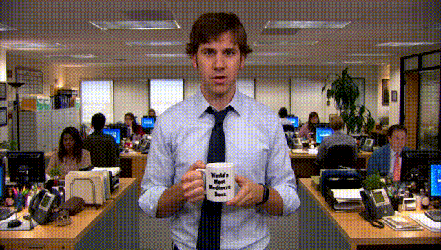
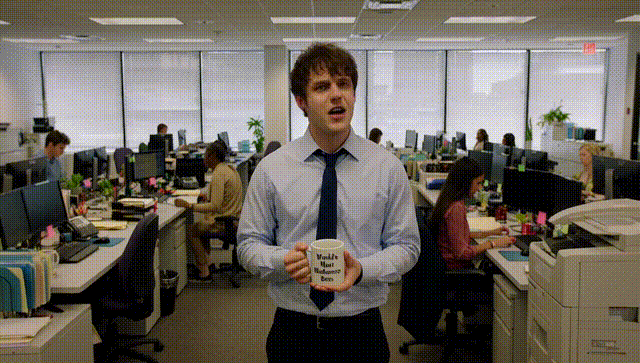
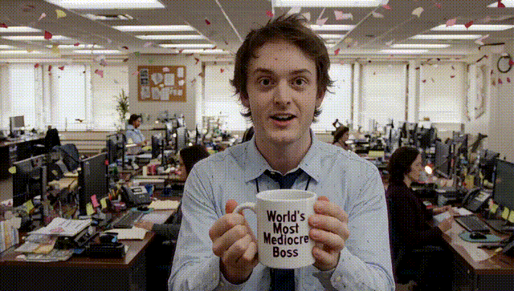
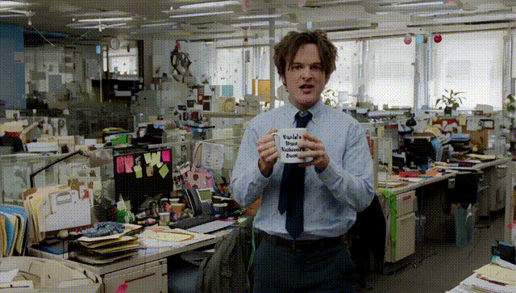
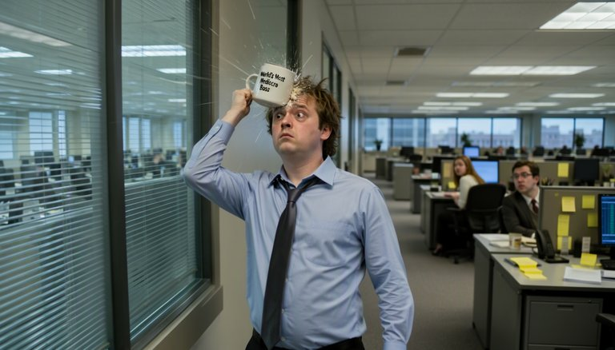
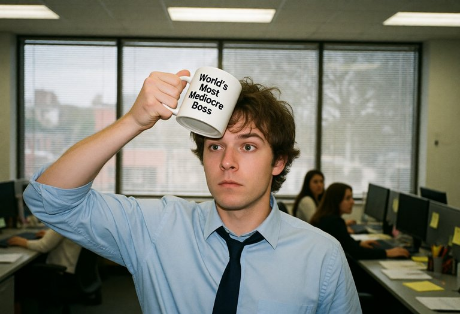
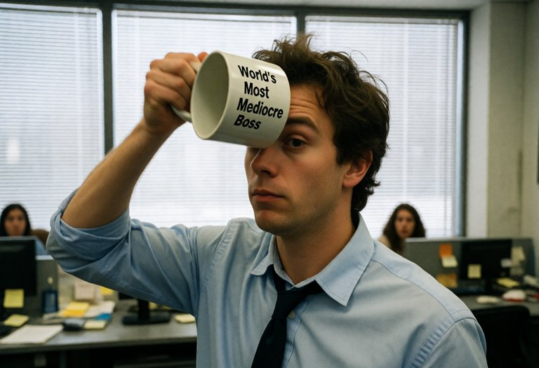
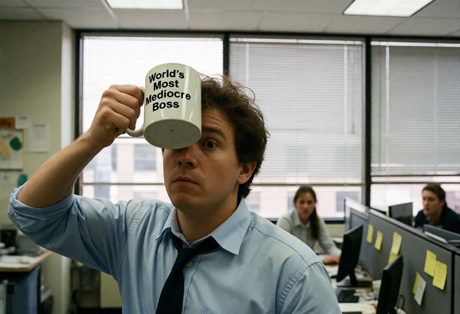

# SPEED Evidence — Office Mug Clip (H3) and Stills (image models)

Same seed, same prompt ("World's Most Mediocre Boss" office mockumentary) — 1× RTX 5080 + 128GB RAM unless noted. All at `960×544`, 24fps, 10.125s. Full 10s GIFs at 360p 12fps

Native is full-res Euler (no SPEED): **571.49s**.

> **V2 evidence scope:** this directory is the existing Euler reference set. V2 adds four more supported samplers, but these GIFs/timings do **not** establish speed or quality parity for Heun, DPM2, Exp Heun 2 X0, or RES Multistep. Re-harvest and benchmark the sampler/model/scheduler combination you actually use. Unless a run is explicitly labelled otherwise, this evidence should also not be read as proving a quality advantage for one noise policy over another.

## Δ=0.005, noise_amplitude=12.105, noise_decay_exponent=0.773

| Mode | Time | Speedup | GIF |
|------|------|---------|-----|
| Native | 571.49s | 1× |  |
| 2-stage 0.5→1.0 | 462.96s | 1.23× |  |
| 3-stage 0.33→0.66→1.0 | 438.85s | 1.30× |  |
| 4-stage 0.25→0.5→0.75→1.0 | 435.21s | 1.31× |  |


## Δ0.010, noise_amplitude=12.436, noise_decay_exponent=0.786

| Mode | Time | Speedup | GIF |
|------|------|---------|-----|
| 2-stage 0.5→1.0 | 450.38s | 1.27× |  |
| 3-stage 0.33→0.66→1.0 | 409.83s | 1.39× |  |
| 4-stage 0.25→0.5→0.75→1.0 | 384.13s | 1.49× |  |


## Δ0.050, noise_amplitude=6.920, noise_decay_exponent=0.766

| Mode | Time | Speedup | GIF |
|------|------|---------|-----|
| 2-stage 0.5→1.0 | 278.44s | 2.05× |  |
| 3-stage 0.33→0.66→1.0 | 262.32s | 2.18× |  |
| 4-stage 0.25→0.5→0.75→1.0 | 237.57s | 2.41× |  |


## Image models (`model_type = image`) — the same gag as a still

The mug gag as one frame: he throws the "World's Most Mediocre Boss" mug at the window and it bounces back into his forehead. Each prompt follows its model's prompting study (MOSS: plain prose, one sentence per element, no quality prefix; Kroma: quality prefix, medium first, text clause, key concept repeated at the end). The workflows are [`workflows/image_moss_SPEED.json`](../workflows/image_moss_SPEED.json) and [`workflows/image_kroma_SPEED.json`](../workflows/image_kroma_SPEED.json).

**Machine:** RTX 5070 Laptop (8 GB) + 30 GB RAM, ComfyUI 0.41.0. Times are wall-clock per queued prompt with models already loaded and the prompt encoded (sampling + VAE decode), read at 1 s resolution; repeats agreed within about 1 s, except Kroma Automatic 2-stage (12 s, then 15 s on seed 2). Not comparable to the RTX 5080 video numbers above.

SPEED changes the composition against plain at the same seed, because the first stage draws its noise at the coarse size. Every run below was clean (no seams, banding or colour shifts) and kept the mug text legible; compare looks, not pixels.

### MOSS-Image

`mossImage_sft_pruned_int8`, 1344×768, 20 steps, CFG 5, euler / sgm_uniform, SLG (uncond skip, layer 22), empty negative, seed 1. Harvest (Δ 0.005): `noise_amplitude 39.79`, `noise_decay_exponent 0.987`, r² 0.88 (good).

<details><summary>Prompt</summary>

```
A candid photograph, a still from a live-action office mockumentary. A young man in his late twenties with tousled brown hair, wearing a light blue button-down shirt and a loosened dark tie, stands in the aisle of a dull open-plan office. The white ceramic mug he has just thrown has bounced back off the large office window behind him and smacks him squarely in the middle of his forehead, frozen at the moment of impact. His eyes are wide and his face is perfectly deadpan, and his throwing arm is still half raised. The mug reads "World's Most Mediocre Boss" in black letters. Behind him the window glass is unbroken, with closed blinds. Around him are grey desks with monitors and yellow sticky notes under flat fluorescent ceiling light. In the background two coworkers at their desks freeze and stare at him. Medium shot at chest height, with the man centred and his face and the mug in sharp focus.
```
</details>

| Mode | Time | Speedup | Notes |
|------|------|---------|-------|
| Plain (SamplerCustomAdvanced) | 23 s | 1× | 22.1 / 23.0 / 23.2 s over three runs |
| Harvest | 23 s | — | one full-resolution pass |
| Automatic, 2 stages, Δ 0.005 | 21 s | 1.08× | sgm_uniform keeps sigma high: 0.5× stage ends at step 2 |
| Automatic, 2 stages, Δ 0.05 | 19 s | 1.2× | |
| Automatic, 3 stages, Δ 0.05 | 18 s | 1.27× | 18 s on seed 2 too |
| Automatic, 4 stages, Δ 0.05 | 19 s | 1.2× | drew a second mug |
| Manual, 0.5× to step 5 of 20 | 19 s | 1.2× | |
| Manual, 0.5× to step 8 of 20 | 16 s | 1.4× | |
| Manual, 0.5× to step 10 of 20 | 15 s | **1.5×** | 15 s on seed 2 too |

| Plain 23 s | Automatic 3 stages Δ 0.05, 18 s | Manual to step 10, 15 s |
|---|---|---|
|  |  |  |

### Kroma (Krea 2 finetune)

`kromaKrea2_opd`, 1216×832, 8 steps, CFG 1, euler / simple, zeroed negative, seed 291. Harvest (Δ 0.005): `noise_amplitude 9.60`, `noise_decay_exponent 0.610`, r² 0.69 (fair).

<details><summary>Prompt</summary>

```
masterpiece, best quality, candid 35mm film photograph, real person, natural skin texture: a still from a live-action office mockumentary. A young man in his late twenties with tousled brown hair, wearing a light blue button-down shirt and a loosened dark tie, stands in the aisle of a dull open-plan office with his throwing arm still half raised. The white ceramic mug he has just thrown has bounced back off the large window behind him and smacks him squarely in the middle of his forehead, caught at the moment of impact; his eyes are wide and his face is perfectly deadpan. The mug reads "World's Most Mediocre Boss" in large, clear letters, and there is no other text. Behind him the unbroken window has closed blinds, grey desks with monitors and yellow sticky notes sit under flat fluorescent light, and far behind him two coworkers at their desks freeze and stare at him. Medium shot at chest height. mug hitting his forehead, deadpan office worker
```
</details>

| Mode | Time | Speedup | Notes |
|------|------|---------|-------|
| Plain (SamplerCustomAdvanced) | 16 s | 1× | 17.0 / 16.0 / 15.4 s over three runs |
| Harvest | 18 s | — | |
| Automatic, 2 stages, Δ 0.005 | 15 s | 1.07× | 0.5× stage ends at step 1 |
| Automatic, 2 stages, Δ 0.05 | 12 s | 1.33× | 15 s on seed 2 |
| Automatic, 3 stages, Δ 0.05 | 12 s | 1.33× | |
| Automatic, 4 stages, Δ 0.05 | 12 s | 1.33× | |
| Manual, 0.5× to step 2 of 8 | 13 s | 1.23× | |
| Manual, 0.5× to step 3 of 8 | 12 s | 1.33× | |
| Manual, 0.5× to step 4 of 8 | 11 s | **1.45×** | 12 s on seed 2 |

| Plain 16 s | Automatic 3 stages Δ 0.05, 12 s | Manual to step 4, 11 s |
|---|---|---|
|  |  |  |

Kroma draws him pressing the mug to his forehead rather than being hit by it, with or without SPEED; that is the prompt, not the sampler.

### What this shows

- At Δ 0.005 the harvested boundary falls in the first one or two steps on both models, so the saving is small (7–8%). **Δ 0.05**, or a Manual boundary near half the schedule, is the useful setting for images.
- A short schedule leaves little to save: Kroma's 8 steps top out around 1.45×, MOSS's 20 CFG-5 steps at 1.5×.
- Fixed per-run costs such as the VAE decode are a larger share of a still than of a 10 s video, so image speedups are below the H3 ones above.
