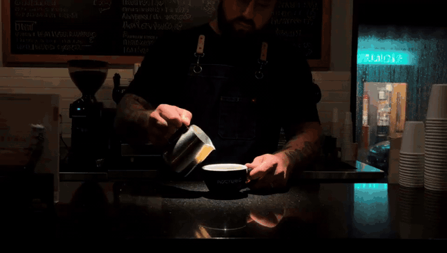
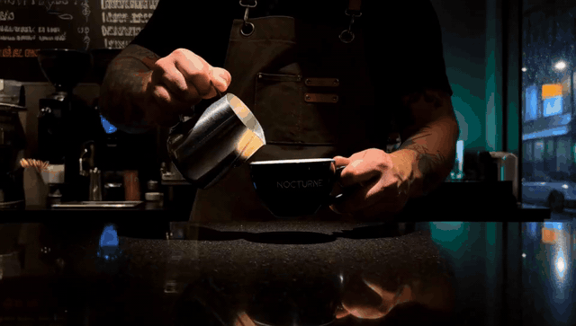
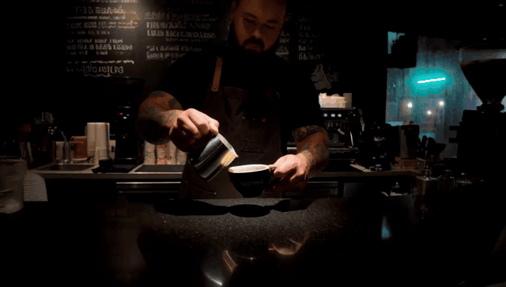
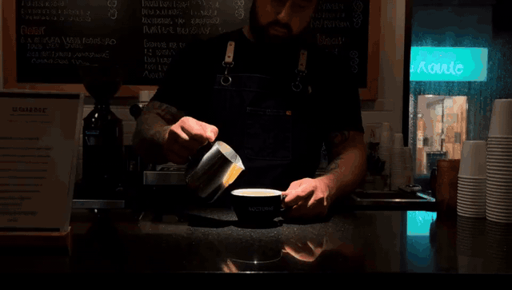
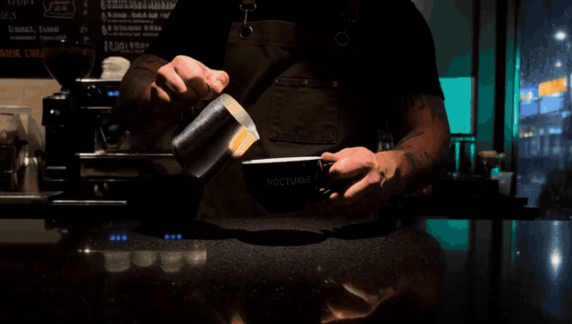
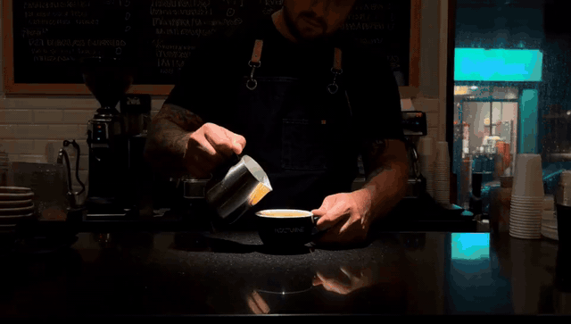
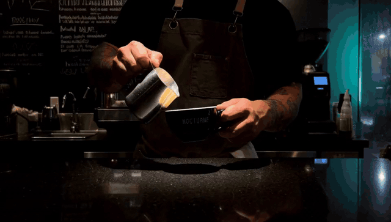

# SPEED Evidence: Night Barista Clip (H3 video)

Same seed, same prompt (a latte-art pour under a spotlight in a dark café, in [prompt.txt](prompt.txt)), on one Modal L40S (48 GB). All at `960×544`, 24 fps, 124 frames (5.17 s), with audio. GIFs are the full clip at 640 px and 12 fps; the MP4 links are the original renders, attached to the [evidence-h3-2026-10](https://github.com/StanLukuvka/ComfyUI-MiniMax-H3-SPEED/releases/tag/evidence-h3-2026-10) release, which also has `compare_all.mp4`, a grid of all ten.

The prompt is built to show sampler damage: a dark scene for tint pulses, small printed lettering ("NOCTURNE") and a latte-art pattern for fine detail, a speckled stone counter for texture, and a slow push-in so any detail drift is visible.

Settings: `minimax_h3_fl2va_pruned_int8_convrot`, euler, simple scheduler, 20 steps, BasicGuider, seed 960012452433733. SPEED runs use `direct_coarse` and seed_offset 10000.

Timing: an untimed Sigma Harvest run first loaded the models and cached the prompt encoding, so each time below is a warm ComfyUI queue-to-finish time, including the VAE decode. The runs used two container sessions: Δ 0.005 in the first, Δ 0.01 and 0.05 in the second. Native was timed in both (276.2 s and 288.2 s; the two renders are identical), and each speedup is against the native time from its own session.

Native is full-resolution Euler (SamplerCustomAdvanced, no SPEED): **276.2 s** and **288.2 s** in the two sessions.

> **Scope:** this is an Euler reference set. It does not establish speed or quality parity for the other supported samplers. Re-harvest and benchmark the sampler, model and scheduler you actually use. It also does not show a quality advantage for one noise policy over another.

All three groups use one calibration from a Sigma Harvest run on this prompt and seed: noise_amplitude 35.4213, noise_decay_exponent 1.0126 (r² 0.83, health good).

## Δ 0.005

Native in the same session: 276.2 s.

| Mode | Time | Speedup | GIF | Video |
|------|------|---------|-----|-------|
| Native | 276.2 s | 1× |  | [MP4](https://github.com/StanLukuvka/ComfyUI-MiniMax-H3-SPEED/releases/download/evidence-h3-2026-10/NATIVE.mp4) |
| 2-stage 0.5→1.0 | 238.2 s | 1.16× |  | [MP4](https://github.com/StanLukuvka/ComfyUI-MiniMax-H3-SPEED/releases/download/evidence-h3-2026-10/0.005_2_stage.mp4) |
| 3-stage 0.33→0.66→1.0 | 236.2 s | 1.17× |  | [MP4](https://github.com/StanLukuvka/ComfyUI-MiniMax-H3-SPEED/releases/download/evidence-h3-2026-10/0.005_3_stage.mp4) |
| 4-stage 0.25→0.5→0.75→1.0 | 226.5 s | 1.22× |  | [MP4](https://github.com/StanLukuvka/ComfyUI-MiniMax-H3-SPEED/releases/download/evidence-h3-2026-10/0.005_4_stage.mp4) |

## Δ 0.01

Native in the same session: 288.2 s.

| Mode | Time | Speedup | GIF | Video |
|------|------|---------|-----|-------|
| 2-stage 0.5→1.0 | 238.2 s | 1.21× |  | [MP4](https://github.com/StanLukuvka/ComfyUI-MiniMax-H3-SPEED/releases/download/evidence-h3-2026-10/0.01_2_stage.mp4) |
| 3-stage 0.33→0.66→1.0 | 226.2 s | 1.27× |  | [MP4](https://github.com/StanLukuvka/ComfyUI-MiniMax-H3-SPEED/releases/download/evidence-h3-2026-10/0.01_3_stage.mp4) |
| 4-stage 0.25→0.5→0.75→1.0 | 224.2 s | 1.29× |  | [MP4](https://github.com/StanLukuvka/ComfyUI-MiniMax-H3-SPEED/releases/download/evidence-h3-2026-10/0.01_4_stage.mp4) |

## Δ 0.05

Native in the same session: 288.2 s.

| Mode | Time | Speedup | GIF | Video |
|------|------|---------|-----|-------|
| 2-stage 0.5→1.0 | 206.2 s | 1.40× |  | [MP4](https://github.com/StanLukuvka/ComfyUI-MiniMax-H3-SPEED/releases/download/evidence-h3-2026-10/0.05_2_stage.mp4) |
| 3-stage 0.33→0.66→1.0 | 194.2 s | 1.48× |  | [MP4](https://github.com/StanLukuvka/ComfyUI-MiniMax-H3-SPEED/releases/download/evidence-h3-2026-10/0.05_3_stage.mp4) |
| 4-stage 0.25→0.5→0.75→1.0 | 182.2 s | 1.58× |  | [MP4](https://github.com/StanLukuvka/ComfyUI-MiniMax-H3-SPEED/releases/download/evidence-h3-2026-10/0.05_4_stage.mp4) |

All ten clips have zero colour-flash jumps (frame-to-frame mean change above 12). SPEED takes a different noise path, so the composition differs from native, but every run keeps the pour, the rosetta, the lift-away and readable lettering.

Image-model evidence is in [image_evidence](../image_evidence/README.md).
