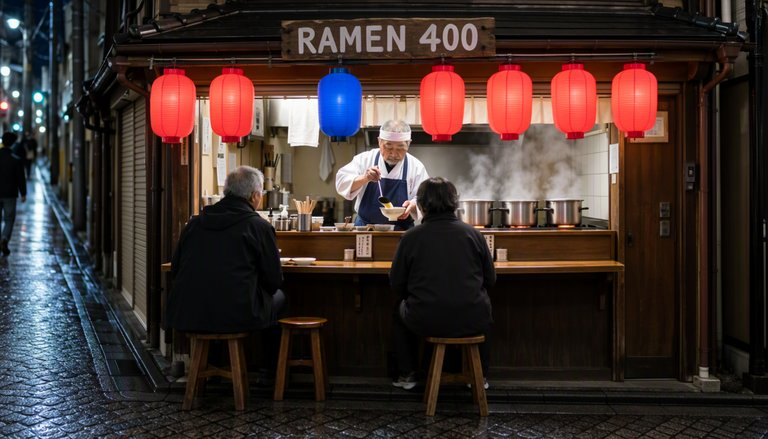
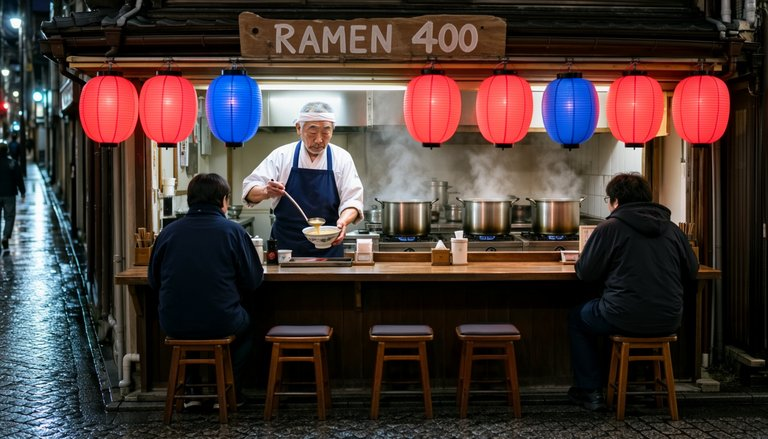
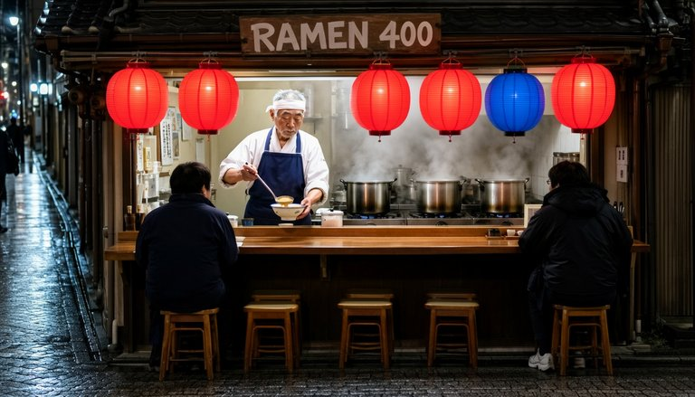
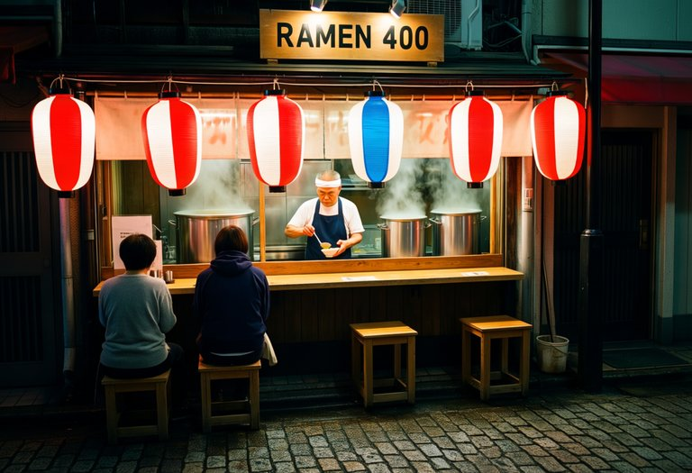
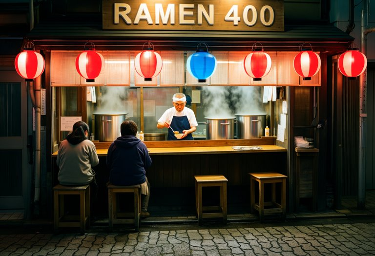
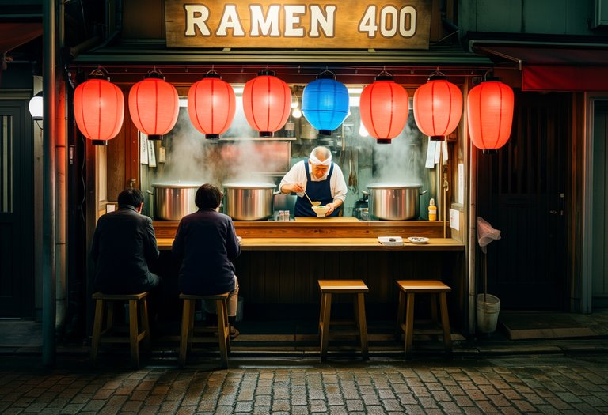

# SPEED Evidence: Image Models (`model_type = flow_image`)

One still per model: a ramen stall on a Tokyo side street at night, with a readable sign, a cook, two customers and a row of paper lanterns. The workflows are [`workflows/image_moss_SPEED.json`](../../workflows/image_moss_SPEED.json) and [`workflows/image_krea2_SPEED.json`](../../workflows/image_krea2_SPEED.json).

**Machine:** RTX 5070 Laptop (8 GB) + 30 GB RAM, ComfyUI 0.41.0. Times are per queued prompt with the models already loaded, including the VAE decode. They are not comparable to the Modal L40S numbers in [h3_evidence](../h3_evidence/README.md).

All SPEED runs use `noise_policy = coupled_full_grid`, which uses the same seed noise as a plain run. So the plain image at the same seed is the reference.

## MOSS-Image

`mossImage_sft_pruned_int8`, 1344×768, 20 steps, CFG 5, euler / sgm_uniform, seed 1. Harvest: `noise_amplitude 48.4075`, `noise_decay_exponent 1.0333`.

<details><summary>Prompt</summary>

```
A candid photograph of a small ramen stall on a narrow Tokyo side street at night. An elderly cook with short grey hair, a white headband and a navy apron ladles broth into a bowl behind the wooden counter. Steam rises from three large silver pots on the stove behind him. A hand-painted wooden sign above the stall reads "RAMEN 400" in white letters. Exactly six plain paper lanterns with no writing on them hang in a row along the eave. Five of the lanterns are red, and the third lantern from the left is blue. Two customers sit on wooden stools at the counter with their backs to the camera. Wet cobblestones in the foreground reflect the lantern light. Medium-wide shot at eye level, with the cook centred and his face in sharp focus.
```
</details>

| Mode | Time | Speedup |
|------|------|---------|
| Plain | 22 s | 1× |
| Automatic, 2 stages, Δ 0.005 | 21 s | 1.07× |
| Automatic, 2 stages, Δ 0.05 | 18 s | 1.21× |
| Automatic, 3 stages, Δ 0.05 | 18 s | 1.26× |
| Automatic, 4 stages, Δ 0.05 | 18 s | 1.27× |
| Manual, 0.5× to step 10 of 20 | 14 s | **1.54×** |

| Plain 22 s | Automatic 3 stages Δ 0.05, 18 s | Manual to step 10, 14 s |
|---|---|---|
|  |  |  |

## Krea 2

`krea2Raw_v10_full_fp8`, 1216×832, 52 steps, CFG 3.5, euler / simple, seed 291. Harvest: `noise_amplitude 9.7616`, `noise_decay_exponent 0.6308`.

<details><summary>Prompt</summary>

```
masterpiece, best quality, candid 35mm film photograph, real person, natural skin texture: a small ramen stall on a narrow Tokyo side street at night. An elderly cook with short grey hair, a white headband and a navy apron ladles broth into a bowl behind the wooden counter, with steam rising from three large silver pots behind him. The wooden sign above the stall reads "RAMEN 400" in large, clear letters, and there is no other text. Exactly six plain paper lanterns hang in a row along the eave: five are red, and the third lantern from the left is blue. Two customers sit on wooden stools at the counter with their backs to the camera, and wet cobblestones in the foreground reflect the lantern light. Medium-wide shot at eye level. ramen stall, six paper lanterns, one blue lantern, elderly cook
```
</details>

| Mode | Time | Speedup |
|------|------|---------|
| Plain | 283 s | 1× |
| Automatic, 2 stages, Δ 0.005 | 271 s | 1.04× |
| Automatic, 2 stages, Δ 0.05 | 226 s | 1.25× |
| Automatic, 3 stages, Δ 0.05 | 215 s | 1.31× |
| Automatic, 4 stages, Δ 0.05 | 252 s | 1.12× |
| Manual, 0.5× to step 26 of 52 | 183 s | **1.55×** |

The 13 GB Krea 2 model does not fit in 8 GB of VRAM, so its times vary by tens of seconds between runs. Treat its Automatic speedups as rough.

| Plain 283 s | Automatic 3 stages Δ 0.05, 215 s | Manual to step 26, 183 s |
|---|---|---|
|  |  |  |

## Summary

- SPEED keeps the plain image's scene and sign. Small details such as the lantern count can change.
- Every run was clean, with no seams, banding or colour shifts.
- For images, use **Δ 0.05**, or Manual with the 0.5× stage ending at half the steps (about 1.55× on both models). At Δ 0.005 the low-resolution stage is too short to save much.
