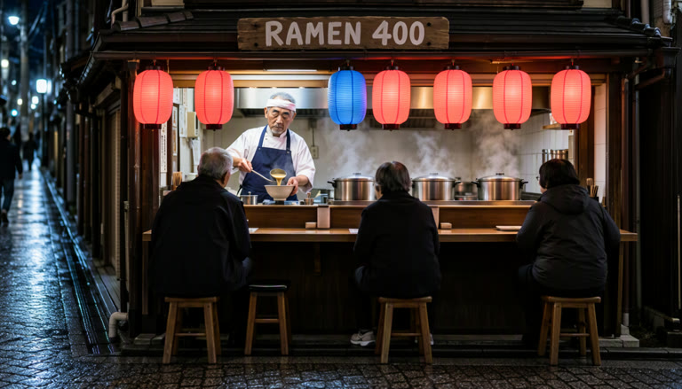
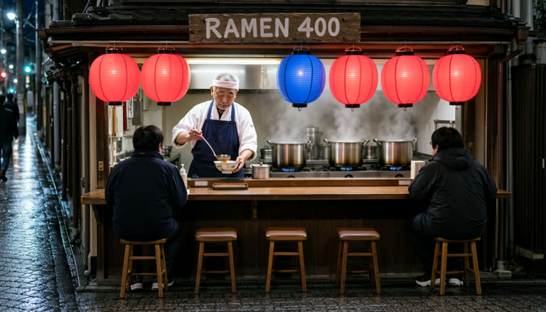
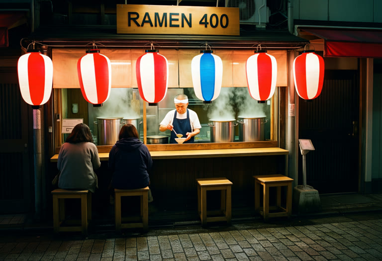

# SPEED Evidence: Night Ramen Stall (image models)

Same prompt per model (a ramen stall on a Tokyo side street at night, in [prompt_moss.txt](prompt_moss.txt) and [prompt_krea2.txt](prompt_krea2.txt)), same seed per model, on one RTX 5070 Laptop (8 GB) with 30 GB RAM and ComfyUI 0.41.0. Images are shown at 768 px wide. The workflows are [`workflows/image_moss_SPEED.json`](../../workflows/image_moss_SPEED.json) and [`workflows/image_krea2_SPEED.json`](../../workflows/image_krea2_SPEED.json).

The prompt is built to show sampler damage: a dark street for colour shifts, a readable "RAMEN 400" sign for fine detail, and a row of lanterns, a cook and two customers, so composition changes are easy to see.

Settings: euler, CFGGuider, `model_type = flow_image`, SPEED runs with `noise_policy = coupled_full_grid` and seed_offset 10000. The model, size, steps, CFG, scheduler and seed are under each model. `coupled_full_grid` uses the same seed noise as a native run, so the native image at the same seed is the reference. The Δ is part of each mode, because each model has one table.

Timing: each time is a ComfyUI queue-to-finish time with the models already loaded and the prompt encoded, including the VAE decode. Times are rounded to whole seconds; each speedup is computed from the unrounded times, so two rows can show the same time with different speedups. These times are not comparable to the Modal L40S numbers in [h3_evidence](../h3_evidence/README.md). Krea 2's 13 GB model does not fit in 8 GB of VRAM, so its times vary by tens of seconds between runs.

> **Scope:** this is an Euler reference set. It does not establish speed or quality parity for the other supported samplers. Re-harvest and benchmark the sampler, model and scheduler you actually use. It also does not show a quality advantage for one noise policy over another.

Native is full-resolution Euler (SamplerCustomAdvanced, no SPEED). Each model has its own calibration from one Sigma Harvest run on its prompt and seed.

## MOSS-Image

`mossImage_sft_pruned_int8`, 1344×768, 20 steps, CFG 5, sgm_uniform scheduler, seed 1. Calibration: noise_amplitude 48.4075, noise_decay_exponent 1.0333 (r² 0.90, health good). Native took **22.3 s** and **22.2 s** in two runs; the 3-stage and Manual times are the means of three runs (17.6, 17.7, 17.4 s and 14.4, 14.7, 14.2 s).

| Mode | Time | Speedup | Image |
|------|------|---------|-------|
| Native | 22 s | 1× |  |
| 2-stage 0.5→1.0, Δ 0.005 | 21 s | 1.07× |  |
| 2-stage 0.5→1.0, Δ 0.05 | 18 s | 1.21× |  |
| 3-stage 0.33→0.66→1.0, Δ 0.05 | 18 s | 1.26× |  |
| 4-stage 0.25→0.5→0.75→1.0, Δ 0.05 | 18 s | 1.27× |  |
| Manual 0.5→1.0, switch at step 10 of 20 | 14 s | 1.54× |  |

## Krea 2

`krea2Raw_v10_full_fp8`, 1216×832, 52 steps, CFG 3.5, simple scheduler, seed 291. Calibration: noise_amplitude 9.7616, noise_decay_exponent 0.6308 (r² 0.63, health fair). Native: **283 s**. That time comes from the same settings at seed 10291, because the seed-291 native render was not timed; the seed changes the noise, not the work per step. Each Krea 2 row is a single run.

| Mode | Time | Speedup | Image |
|------|------|---------|-------|
| Native | 283 s | 1× |  |
| 2-stage 0.5→1.0, Δ 0.005 | 271 s | 1.04× |  |
| 2-stage 0.5→1.0, Δ 0.05 | 226 s | 1.25× |  |
| 3-stage 0.33→0.66→1.0, Δ 0.05 | 215 s | 1.31× |  |
| 4-stage 0.25→0.5→0.75→1.0, Δ 0.05 | 252 s | 1.12× |  |
| Manual 0.5→1.0, switch at step 26 of 52 | 183 s | 1.55× |  |

Judged by eye, every run is clean, with no seams, banding or colour shifts, and keeps the sign legible. SPEED keeps the native image's scene, but small details such as the lantern count can change. At Δ 0.005 the low-resolution stage ends in the first few steps and saves little, so use Δ 0.05, or Manual with the switch at half the steps (about 1.55× on both models).

H3 video evidence is in [h3_evidence](../h3_evidence/README.md).
